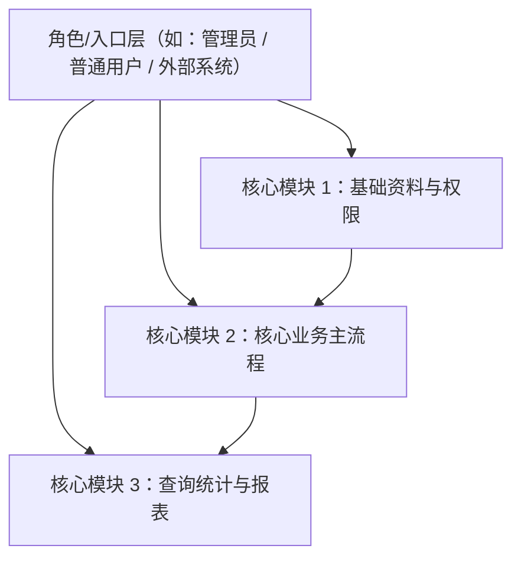
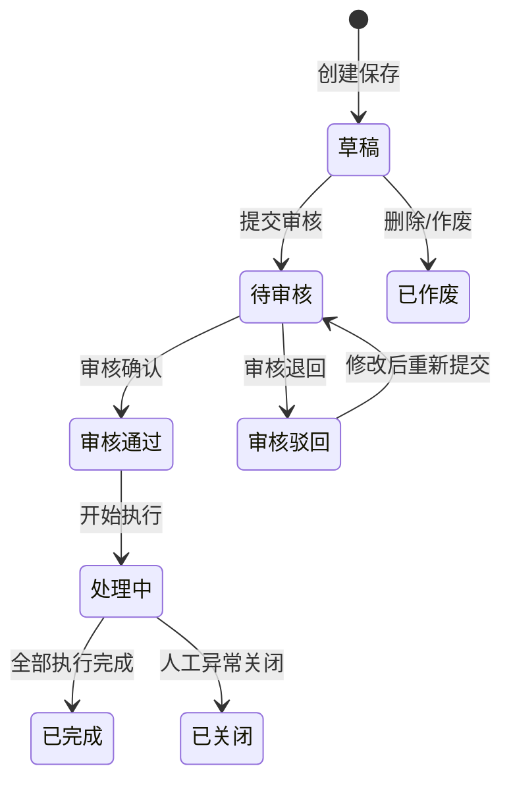

# 中文《需求规格说明书》（SRS）标准模板

本模板用于 Stage 1（`ai-project-briefing`）产出 `specs/project-brief-spec.md`（以及大型项目拆分后的 `specs/modules/<module>.md`）。
文档**正文、章节标题、表格内容与说明均使用中文**，专有名词或建议逻辑字段名可中英对照，物理 DDL 与技术栈选型不在此阶段定死（留给 Stage 2 / Stage 3）。

---

```markdown
# 《[项目名称] 需求规格说明书》

> **文档状态**：草稿 / 已确认（v1.0）
> **更新日期**：YYYY-MM-DD
> **适用范围**：v1 MVP 需求基线（对应 `specs/project-brief-spec.md`）
> **下游衔接**：作为 Stage 2（技术选型）、Stage 3（数据库设计）、Stage 4（前端骨架）、Stage 5（后端 API 规划）与项目验收的唯一需求真源

---

## 1 引言

### 1.1 目的

本需求规格说明书旨在明确 **[项目名称]** 的核心业务场景、功能需求、非功能需求、业务约束与验收标准，为后续架构设计、数据库建模、前后端开发、测试验证及业务验收提供统一依据。本文档面向业务决策者、产品设计人员、开发工程师及测试人员，确保各方对第一版（v1 MVP）边界与核心流程达成一致理解。

### 1.2 范围

本项目适用于 **[适用组织 / 目标客户群]** 的 **[核心业务域]** 场景，第一版（v1）涵盖以下核心业务模块：

- **[模块 1 名称]**：[一句话概括涵盖范围，如：基础主档与权限配置]
- **[模块 2 名称]**：[一句话概括涵盖范围，如：核心单据创建、审核与状态流转]
- **[模块 3 名称]**：[一句话概括涵盖范围，如：查询、统计看板与导出]

**v1 明确不涵盖边界（Non-Goals）**：
- [明确排除项 1，如：暂不支持多币种与自动对账]
- [明确排除项 2，如：暂不对接外部 ERP/硬件扫码枪，先支持网页端操作]

### 1.3 目标与读者对象

**业务与产品目标：**
- [可衡量目标 1，如：将手工登记流程线上化，单据处理耗时缩短至 X 分钟内]
- [可衡量目标 2，如：实现状态实时可查与操作留痕，减少人工错漏]
- [可衡量目标 3，如：支持首年 X 级用户/数据规模稳定运行并可扩展至后续阶段]

**读者对象及阅读重点：**

| 读者角色 | 核心关注章节 | 用途 |
|----------|--------------|------|
| 业务方 / 产品负责人 | 第 1 章、第 2 章、3.X 用例描述与异常流 | 确认业务流程、规则口径与 MVP 取舍 |
| 架构与后端开发（Stage 2/3/5/6） | 2.4–2.6 权限与状态机、3.X 前置/后置/数据描述 | 设计技术栈、库表结构、接口契约与权限拦截 |
| 前端与 UI 设计（Stage 4） | 2.2 核心流程、3.X 事件流/可选事件流/补充说明 | 设计路由、页面布局、三态交互与表单校验 |
| 测试与验收人员（Stage 7/8/9） | 3.X 前置条件/异常流/后置条件、4.3 验收标准 | 编写正常流、异常流与越权拦截测试用例 |

### 1.4 术语与缩写

| 术语 / 缩写 | 英文全称（如适用） | 中文说明 |
|-------------|--------------------|----------|
| [术语 1] | [Full Name] | [清晰定义该术语在本系统中的含义] |
| [术语 2] | [Full Name] | [清晰定义该术语在本系统中的含义] |

---

## 2 系统介绍

### 2.1 概述

- **一句话定位**：[产品是什么，面向谁，解决什么核心痛点]
- **目标用户**：[核心使用者画像与使用频率]
- **核心痛点与现有替代方案不足**：[用户目前怎么解决（如 Excel/微信群/人工），为什么不够好]
- **产品价值与差异化优势**：[相比现有方案的核心优势]
- **初始产品形态倾向**：[网页应用 / 管理后台 / 小程序 / 移动 App / 纯 API 服务，待 Stage 2 最终定栈]
- **部署与外部约束（仅记录业务要求）**：[如：需支持内网部署 / 需微信登录 / 需对接某现有系统，具体框架留给 Stage 2]

### 2.2 业务架构与核心流程

**业务模块架构：**



**端到端主业务流程：**


### 2.3 业务领域 Q&A

> 用于拉齐非技术决策者与研发团队对行业口径、核心边界与取舍逻辑的认知。

- **Q1：本系统最核心解决什么场景的问题？哪些业务最适合用它？**
  A：[结合具体行业与痛点回答]
- **Q2：系统主要由哪几大模块组成，它们之间如何协同？**
  A：[简述各模块职责与上下游单据/数据流向]
- **Q3：本系统有哪些必须守住的关键业务规则（红线）？**
  A：[例如：先审核后执行、库存不足不允许出库、普通用户只能看自己名下数据等]
- **Q4：第一版暂不自动化的环节，人工如何配合兜底？**
  A：[说明 v1 人工兜底方式，避免需求无限膨胀]

### 2.4 角色与权限矩阵概览

> 本表直接作为 Stage 5（API 权限设计）和 Stage 8（垂直/水平越权审计）的业务依据。

| 角色名称 | 角色定位 | 可访问模块/操作 | 数据归属范围（水平权限） | 特殊约束 |
|----------|----------|-----------------|--------------------------|----------|
| 超级管理员 | 系统全局配置与运维 | 全模块查看与配置 | 全局数据 | 强制强密码与高敏感操作留痕 |
| 业务审核员 / 运营 | 业务审核与异常处理 | 审核、导出、统计 | 所属部门/租户或全局 | 不可篡改已完结单据核心金额 |
| 普通用户 / 业务员 | 日常核心业务操作 | 创建、查询、修改本人草稿 | **仅限本人创建/归属的数据** | 不可越权查看或操作他人数据 |

### 2.5 MVP 边界规划

| 优先级分层 | 模块 / 功能点 | 纳入原因 / 延期原因 |
|------------|---------------|---------------------|
| **v1 必做（P0）** | [功能 A、功能 B、基础权限] | 构成闭环主流程的最小可行集合 |
| **后续迭代（P1/P2）** | [功能 C、批量导入、高级报表] | 提升效率但 v1 可由基础操作或人工替代 |
| **v1 明确不做（Non-Goals）** | [功能 D、复杂工作流引擎] | 避免过度设计，等待首版验证后再评估 |

### 2.6 核心业务对象与状态机概览

**核心业务对象清单（对应 Stage 3 数据库表候选）：**

| 业务对象 | 建议英文标识 | 核心职责 | 归属关系（是否含归属人） | 关键关系 |
|----------|--------------|----------|--------------------------|----------|
| 用户 | `users` | 登录认证、角色权限载体 | 主体 | 1:N 关联业务单据 |
| [核心单据] | `[orders]` | 记录主业务生命周期 | 必须包含归属外键（如 `user_id`） | 1:N 关联明细表 |

**关键业务单据状态机（示例，按项目核心单据绘制）：**



---

## 3 功能用例

> **章节组织规则**：按 `3.X <业务模块>` → `3.X.Y <子模块>` → `3.X.Y.Z <具体用例>` 组织。
> **对称/高度相似用例处理**：对于结构高度一致的辅助用例（如各主档的“启用/禁用”），可在首个用例写出完整 11 项规格表，后续对称用例写明“参考 `3.X.Y` [原用例名]，差异点如下：[列出前置/状态/字段差异]”。
> **禁止省略核心用例**：主流程中的创建、编辑、提交、审核、状态变更、删除/作废、核心查询必须逐一填写标准 11 项用例规格表。

### 3.1 [模块名称，如：基础主档管理]

#### 3.1.1 [用例名称，如：创建并管理基础对象]

| 规范项 | 详细内容 |
|--------|----------|
| **名称** | [用例名称] |
| **优先级** | 高（P0） / 中（P1） / 低（P2） |
| **功能描述** | [说明为什么需要此功能、由什么业务动作触发、达到什么业务效果] |
| **参与者** | [如：管理员 / 普通用户 / 系统定时任务] |
| **前置条件（约束）** | 1. 拥有该功能的角色操作权限；<br>2. 数据状态约束：如仅 `草稿` / `审核驳回` 状态允许修改；<br>3. 唯一性与归属约束：如编码全局唯一、仅操作本人数据； |
| **事件流（操作序列）** | 1. 用户进入 [页面/模块名称]；<br>2. 点击 [新增/操作按钮]，填写或选择必要业务字段；<br>3. 系统校验必填项与业务规则；<br>4. 点击“确认”提交，系统持久化数据并更新状态。 |
| **可选事件流** | 1. **校验不通过分支**：若编码重复 / 数量为负 / 状态不符合前置条件，系统拦截提交并给出明确中文错误提示，保留当前表单输入；<br>2. **取消/返回分支**：点击取消则不落库，返回列表页；<br>3. **并发冲突分支**（如涉及库存/状态抢占）：若他人已先一步变更状态，提示刷新后重试。 |
| **后置条件** | 1. 主表新增或更新记录，默认初始状态为 `[初始状态]`；<br>2. 若涉及自动编号，按规则生成（如：`前缀 + YYYYMMDD + 4位流水号`）；<br>3. 若涉及明细/汇总字段（如总金额、总数量），同步重新计算主表汇总值并记录操作日志。 |
| **数据描述** | **逻辑业务字段（供 Stage 3 设计物理表）：**<br>- 主表核心字段：`字段中文名（建议英文名，类型，必填/选填，业务规则/长度）`<br>- 明细字段（如有）：`明细中文名（建议英文名，类型，必填/选填，约束）`<br>**状态枚举与字典：**<br>- 状态流转：`初始(0) → 待审核(1) → 已通过(2) / 已驳回(3) → 已作废(9)`<br>- 业务字典/分类：[如单据类型枚举]<br>**约束与编码规则：**<br>- 唯一键：[如单号全局唯一，同一单据下明细商品不重复]<br>*(注：若用户已有参考 SQL/DDL 草案，可附在此处作逻辑参考，最终物理表名、索引与外键类型在 Stage 3 `specs/db-design-spec.md` 锁定。)* |
| **补充说明** | 1. 业务规则举例 / 行业常识解释（如：为什么需要锁定批次或先删后插规则）；<br>2. 具体数值示例（如：`SKU001` 数量 `100`，编码示例 `ASN202611250001`）；<br>3. 界面交互提示或原型图位置占位。 |
| **修改历史** | `v1.0 (YYYY-MM-DD)`：初始创建 |

---

## 4 非功能需求、里程碑与验收标准

### 4.1 非功能需求与规模预期

| 维度 | 具体指标与基线要求 | 对下游阶段的影响 |
|------|--------------------|------------------|
| **用户与数据规模** | 首年预计日活/总用户 `[X]` 人，核心单据日增 `[Y]` 条、首年总量 `[Z]` 条 | 影响 Stage 2 架构复杂度与 Stage 3 索引/分页策略 |
| **性能与响应** | 常规查询页面响应 ≤ 2 秒，核心提交操作 ≤ 1 秒；并发峰值 `[N]` QPS | 决定 Stage 3 是否引入缓存、Stage 5 是否采用异步任务 |
| **安全与合规底线** | 密码哈希存储、禁止明文日志、按角色+归属隔离数据、关键状态流转留痕 | 直连 Stage 5 权限表与 Stage 8 安全检查 |
| **终端与兼容性** | 支持 [PC 桌面浏览器 / 移动端 H5 / 微信小程序 / PDA 扫码] | 影响 Stage 4 响应式断点与布局结构 |
| **可用性与备份** | 关键业务数据需软删除，生产数据库需每日自动备份及发布前备份 | 直连 Stage 3 软删字段与 Stage 9 上线门禁 |

### 4.2 里程碑规划

| 里程碑 | 目标范围 | 预计完成标志 |
|--------|----------|--------------|
| **M1：规格与架构基线** | 完成 Stage 1–7（中文 SRS、选型、库表、前端骨架、API、后端骨架验收） | `specs/backend-impl-source-of-truth.md` 验收通过 |
| **M2：MVP 核心闭环** | 实现所有 P0 高优先级用例前后端联调与测试 | 核心业务单据从创建到完成全链路跑通 |
| **M3：安全与上线发布** | 完成 Stage 8 安全审查与 Stage 9 上线检查 | `specs/deploy-checklist.md` 冒烟测试全绿上线 |

### 4.3 验收标准

> 每一条验收标准必须可客观验证，不允许出现“体验良好”“功能完善”等模糊描述。

1. **主流程闭环验收**：[角色] 能按第 3 章 P0 用例从头到尾跑通核心业务操作，数据库状态、自动编号与汇总数量完全准确。
2. **异常与约束拦截验收**：违反前置条件（如重复提交、数量越界、非初始状态编辑）时，系统返回统一错误提示并保持数据一致。
3. **权限与归属隔离验收**：未登录请求返回 401；普通用户跨权访问他人数据或管理员接口时返回 403。
4. **文档与代码一致性**：所有实现的功能模块、字段枚举和状态流转与本文档保持同步更新。

### 4.4 待确认问题（Open Questions）

| 编号 | 待确认问题 | 影响模块 | 当前临时假设 | 状态 |
|------|------------|----------|--------------|------|
| Q-01 | [待确认的业务规则] | [3.X] | [临时按最简单规则实现] | 待确认 / 已闭环 |

### 4.5 AI 协作约束（AI Agent Constraints）

- **需求真源约束**：任何后续代码与接口设计前，必须先查阅 `specs/project-brief-spec.md`（及 `specs/modules/*.md`）。
- **禁止擅自扩scope**：未经用户明确确认，AI 不得在 v1 实现中夹带 P1/P2 或 Non-Goals 列表中的功能。
- **变更先改文档**：当业务规则、状态机或字段约束发生变化时，必须先更新对应功能用例表及 `修改历史`，再修改下游规格与代码。
- **文档语言约束**：需求规格说明书（`specs/project-brief-spec.md` 与 `specs/modules/*.md`）所有新增与修改内容必须保持规范中文。
```
